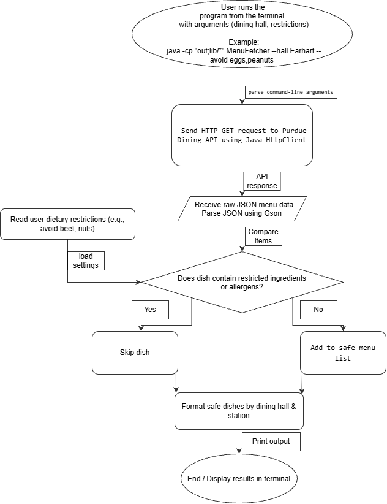

# Purdue Dining Guard

Purdue Dining Guard is a Java command-line application that retrieves and parses daily menu data from Purdue dining halls using the Purdue Dining API. It currently reads information about meals, stations, food items, vegetarian labels, and allergens.

The goal is to make it easier for students to find food that fits their dietary restrictions without having to go through every menu item manually.

## The Problem

Finding food in a dining hall can take extra time when you have dietary restrictions or food allergies. The Purdue Dining app provides menu and ingredient information, but students often have to open individual food items and check their ingredients one by one.

For example, someone who avoids beef or pork for religious or personal reasons may have to check several dishes before finding something suitable. The same applies to students who need to avoid certain allergens.

I started this project to see if I could automate some of that process using the Purdue Dining API.

## How It Works

The program sends a request to the Purdue Dining API and receives menu data in JSON format. It then uses Gson to convert that data into Java objects.

The menu is organized into three main parts:

1. **Meals:** Meal periods such as breakfast, lunch, and dinner.
2. **Stations:** The different food stations within a dining hall.
3. **Items:** Individual food items and their available information, including vegetarian labels and allergen data.

Each item can also contain a list of dietary and allergen-related labels, represented by names and boolean values.

Right now, the program retrieves the Earhart dining hall menu for the current date. It parses the response and prints information about the first meal, station, and food item. Filtering is not implemented yet.

## Data Sources

- **Menu API (v2 REST):** Used to retrieve daily menus, including meals, stations, food items, and available allergen information.
- **Ingredient API (v3 GraphQL):** Planned for retrieving more detailed ingredient information for individual food items.

The v3 GraphQL endpoint is an internal API used by the Purdue Dining website. Since its availability and behavior could change, I plan to keep ingredient requests limited.

**Data limitations:** The API does not always return complete allergen information. For example, some items with `NutritionReady: false` do not have an allergen list. The list can also contain entries such as `Vegetarian` and `Vegan`, which are dietary labels rather than actual allergens. These differences will need to be considered when implementing the filtering system.

## System Architecture



The current program works in the following order:

1. Sends an HTTP GET request to the Purdue Dining API.
2. Receives the menu data as a JSON response.
3. Uses Gson to parse the JSON.
4. Stores the information in Java objects for meals, stations, and items.
5. Prints selected information in the terminal.

Dietary filtering and more organized menu output are planned for future versions.

## Tech Stack

- **Language:** Java
- **HTTP Requests:** Java `HttpClient`
- **JSON Parsing:** Gson
- **Data Source:** Purdue Dining API (v2 REST)
- **Planned Data Source:** Purdue Dining API (v3 GraphQL)
- **Interface:** Command-line application
- **Version Control:** Git and GitHub

## Setup & Usage

### Prerequisites

- Java JDK 25 (currently tested)
- Git
- Gson JAR dependency

### 1. Clone the repository

```bash
git clone https://github.com/Chaitanya-Negi/purdue-dining-guard.git
cd purdue-dining-guard
```

### 2. Compile

From the project root, run:

```bash
javac -cp "lib/*" -d out src/*.java
```

The compiler creates the `out` directory if it does not already exist.

### 3. Run

**Windows (PowerShell):**

```powershell
java -cp "out;lib/*" MenuFetcher
```

**macOS / Linux:**

```bash
java -cp "out:lib/*" MenuFetcher
```

The program currently uses the current date and retrieves the Earhart dining hall menu automatically.

## Example Run

Example input and output will be added once filtering and output formatting are implemented.

## Development Roadmap

### Core Features

- [x] Set up the project structure.
- [x] Connect to the Purdue Dining API using Java `HttpClient`.
- [x] Retrieve daily menu data from the Earhart dining hall.
- [x] Add request headers and handle HTTP status errors.
- [x] Handle network failures and request timeouts.
- [x] Parse menu JSON into Java objects using Gson.
- [x] Model meals, stations, food items, and allergen information.
- [x] Document project setup, API structure, and data limitations.
- [ ] Implement allergen filtering.
- [ ] Implement vegetarian filtering.
- [ ] Add ingredient keyword filtering for beef, pork, and other exclusions.
- [ ] Add command-line arguments for dining hall, date, and dietary restrictions.
- [ ] Display matching food items grouped by meal and station.
- [ ] Handle invalid dining hall names, closed meals, missing data, and empty results.
- [ ] Add an example run with real terminal output to the README.

### Additional Features

- [ ] Add a schedule feature to track daily macronutrient and calorie intake.
- [ ] Integrate ingredient lookups through the v3 GraphQL endpoint.
- [ ] Allow users to save dietary preferences.
- [ ] Explore local caching to reduce repeated API requests.

### Final Improvements

- [ ] Update the README and system architecture diagram as features are added.
- [ ] Record and add a video demonstration of the application.

## Development Notes

I originally started this project as a Python-based menu filtering idea. After looking into the Purdue Dining API, I decided to build it in Java instead.

While exploring the API, I found that the v2 REST endpoint provides menu information but does not include all the detailed ingredient information I needed. I also looked into the v3 GraphQL endpoint, which is where I plan to explore getting those details.

The current version focuses on retrieving and parsing menu data. The next step is to build the filtering features on top of that.

## Demo

Video demonstration coming soon.

## Author

**Chaitanya Negi**

[GitHub Profile](https://github.com/Chaitanya-Negi) | [Project Repository](https://github.com/Chaitanya-Negi/purdue-dining-guard)