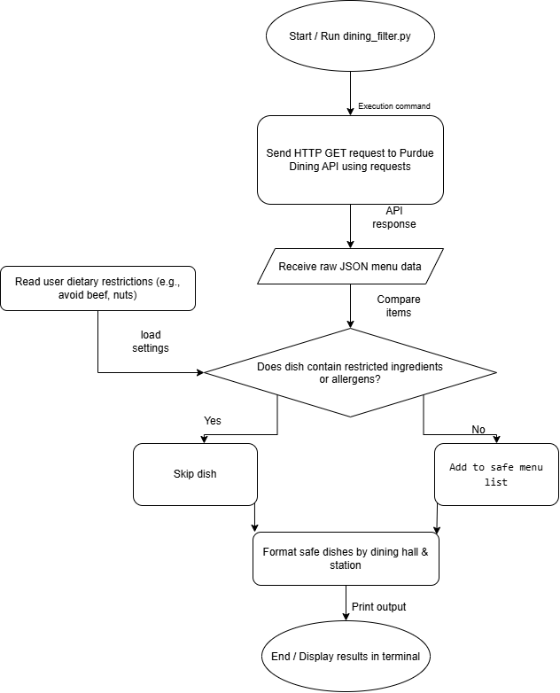

# Purdue Dining Dietary Guard

A Python-based command-line tool that automatically filters Purdue Dining hall menus based on user-selected dietary restrictions, religious preferences, and allergens.

## The Problem

Navigating campus dining halls with strict religious observances (such as avoiding beef or pork as a Hindu or Muslim) or severe food allergies using the official Purdue Dining app is tedious because it requires manually opening long, unbroken ingredient lists for every single dish. This friction increases the risk of overlooking hidden ingredients or making mistakes when trying to find safe, compliant food options across campus.

## How It Works

This tool fetches live daily menu JSON data from the Purdue Dining API, processes the items, and screens them against user-specified dietary filters. Safe options are then cleanly organized and printed by dining hall and food station directly in the terminal.



## Tech Stack

- **Language:** Python
- **Libraries / Modules:** `requests`, `json`
- **Data Storage:** Local JSON files / cache
- **Data Source:** Public Purdue Dining API (HTTP GET)

## Setup & Usage

Step-by-step instructions to get the project running locally:

1. Clone the repository:
   ```bash
   git clone https://github.com/Chaitanya-Negi/purdue-dining-guard.git
   cd purdue-dining-guard
   ```

2. Install dependencies:
   ```bash
   pip install requests
   ```

3. Run the tool:
   ```bash
   python src/dining_filter.py --hall ford --restriction hindu
   ```

## Roadmap (Future Plans)

Features planned for future versions (pulled from the Eisenhower Matrix Schedule quadrant):

- [ ] Add local user profile storage to save favorite dining halls and custom dietary restrictions.
- [ ] Integrate macro-nutrients (calories and protein) tracking for fitness-oriented students.
- [ ] Build a "what can I make with available ingredients" recipe suggestion engine.
- [ ] Implement a community dish rating and review system.
- [ ] Transition the backend logic into a mobile app (iOS/Android) for the App Store.

## Author

Chaitanya Negi — [GitHub Profile](https://github.com/Chaitanya-Negi)